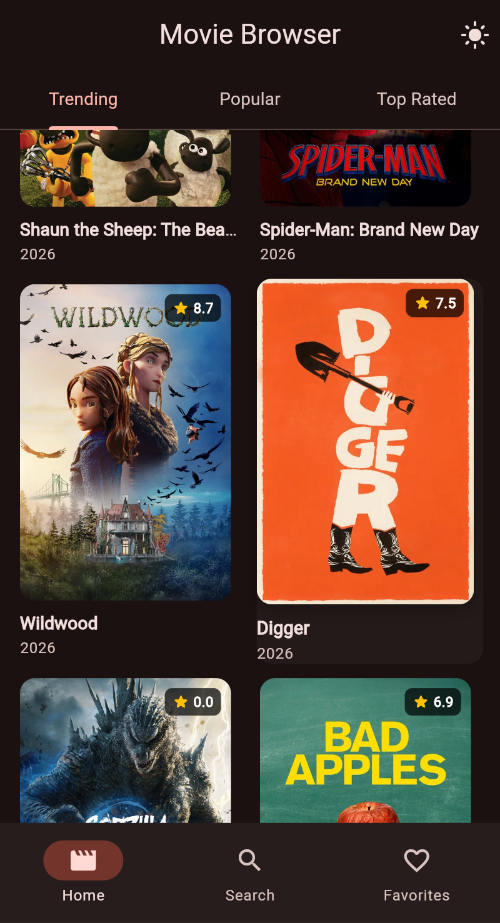
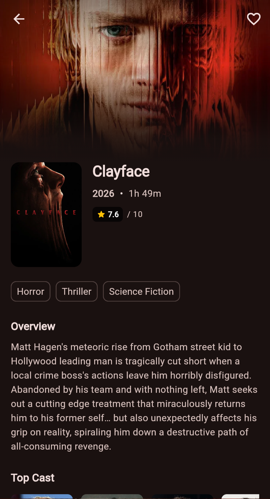
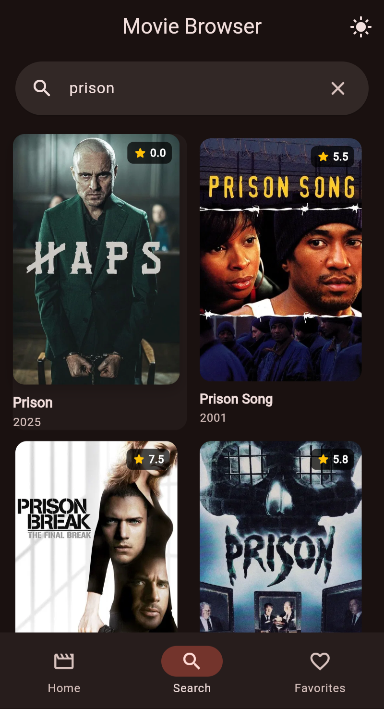
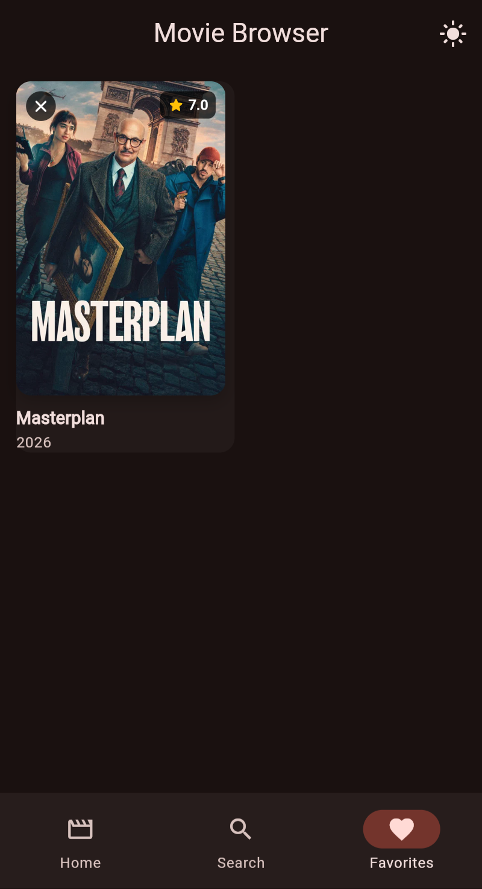

# Movie Browser

A simple, polished Flutter mobile application for browsing movies using the TMDB API.

---

## Screenshots

| Home (Trending & Tabs) | Movie Details & Cast |
|:---:|:---:|
|  |  |

| Real-Time Debounced Search | Saved Favorites |
|:---:|:---:|
|  |  |

---

## Features

- **Home Screen with Tabs**:
  - Three distinct categories: **Trending**, **Popular**, and **Top Rated**.
  - 2-column poster grid with rounded corners and rating badges.
  - Infinite scroll pagination and pull-to-refresh on each category.
  - Tab scroll state preservation when switching categories.

- **Real-Time Debounced Search**:
  - Live movie search with a 500 ms debounce to optimize network calls.
  - Clean hint state before searching.
  - Detailed empty state when no results match the query.
  - Infinite scroll pagination on search results.

- **Movie Detail Screen**:
  - High-resolution backdrop image with smooth gradient overlay.
  - Hero poster transition from grid cards.
  - Title, release year, runtime, and community rating.
  - Genre chips and full overview summary.
  - Horizontally scrolling Top 10 Cast list with profile photos, actor names, and character roles.
  - Persistent favorite toggle button with visual feedback.

- **Favorites with Local Persistence**:
  - Dedicated favorites screen displaying saved movies in a 2-column grid.
  - Persisted locally using `shared_preferences`.
  - Immediate removal directly from the favorites screen or from the detail screen.
  - Friendly empty state when no movies are bookmarked.

- **Material 3 Theme**:
  - Cinematic seed color (`#E50914`) supporting both Light and Dark modes.
  - Quick theme toggle in the application bar with choice persisted locally.
  - Accessible contrast and minimum 48 dp touch targets.

- **Robust State Handling**:
  - Smooth animated shimmer pulse on loading skeleton cards.
  - Informative error screens with dedicated **Retry** buttons on all screens.
  - Contextual empty states for home lists, search queries, and favorites.

---

## Tech Stack

| Purpose | Package |
|---|---|
| **State Management** | [`flutter_riverpod`](https://pub.dev/packages/flutter_riverpod) |
| **HTTP Client** | [`dio`](https://pub.dev/packages/dio) |
| **Navigation** | [`go_router`](https://pub.dev/packages/go_router) |
| **Image Caching** | [`cached_network_image`](https://pub.dev/packages/cached_network_image) |
| **Local Storage** | [`shared_preferences`](https://pub.dev/packages/shared_preferences) |
| **Environment & Secrets** | [`flutter_dotenv`](https://pub.dev/packages/flutter_dotenv) |

- **Design System**: Material 3 (with custom seed color and light/dark theme data)
- **Dart & Architecture**: Pure handwritten models with `fromJson` and `toJson` (no code generation)

---

## Setup Instructions

### Prerequisites
- [Flutter SDK](https://docs.flutter.dev/get-started/install) (3.x stable channel)
- An active [TMDB Account & API Key](https://developer.themoviedb.org/docs/getting-started) (free v3 API key)

### Getting Started

1. **Clone the repository**:
   ```bash
   git clone https://github.com/your-username/movie_browser.git
   cd movie_browser
   ```

2. **Configure your TMDB API Key**:
   Copy `.env.example` to `.env`:
   ```bash
   cp .env.example .env
   ```
   Open `.env` in your editor and insert your TMDB API key:
   ```env
   TMDB_API_KEY=your_actual_tmdb_api_key_here
   ```

3. **Install dependencies**:
   ```bash
   flutter pub get
   ```

4. **Run the application**:
   ```bash
   flutter run
   ```

5. **Run tests & static analysis**:
   ```bash
   flutter test
   flutter analyze
   ```

---

## Folder Structure

```
lib/
├── core/
│   ├── constants.dart        # Base URLs, image sizes, endpoints, and storage keys
│   ├── theme.dart            # Material 3 light and dark ThemeData
│   └── router.dart           # go_router configuration with ShellRoute
├── models/
│   ├── movie.dart            # id, title, posterPath, backdropPath, voteAverage, releaseDate, overview
│   ├── movie_detail.dart     # Movie fields plus runtime, genres, and cast
│   └── cast_member.dart      # id, name, character, profilePath
├── services/
│   ├── tmdb_service.dart     # Dio HTTP client and TMDB API requests
│   └── storage_service.dart  # Favorites and theme mode persistence (shared_preferences)
├── providers/
│   ├── movies_provider.dart      # Trending, popular, and top rated pagination notifiers
│   ├── search_provider.dart      # Debounced search notifier
│   ├── detail_provider.dart      # Movie details family provider
│   ├── favorites_provider.dart   # Favorites list notifier and persistence
│   └── theme_provider.dart       # Theme mode notifier and persistence
├── screens/
│   ├── home_screen.dart      # Category tabs (Trending, Popular, Top Rated)
│   ├── search_screen.dart    # Debounced search bar with result grid
│   ├── detail_screen.dart    # Movie detail, backdrop, overview, and cast list
│   ├── favorites_screen.dart # Locally persisted favorites grid
│   └── shell_screen.dart     # Bottom navigation scaffold and theme toggle
├── widgets/
│   ├── movie_card.dart       # 2:3 poster card with Hero animation and rating
│   ├── rating_badge.dart     # Translucent star badge
│   ├── cast_tile.dart        # Actor photo, name, and character tile
│   ├── error_view.dart       # Friendly error state with retry action
│   ├── empty_view.dart       # Contextual empty state view
│   └── loading_grid.dart     # Pulsating skeleton loading cards
└── main.dart                 # Application entry point, .env loading, and ProviderScope
```

---

## Attribution

> This product uses the TMDB API but is not endorsed or certified by TMDB.
